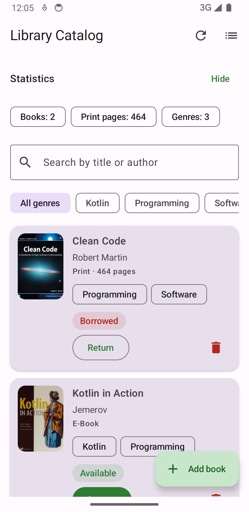
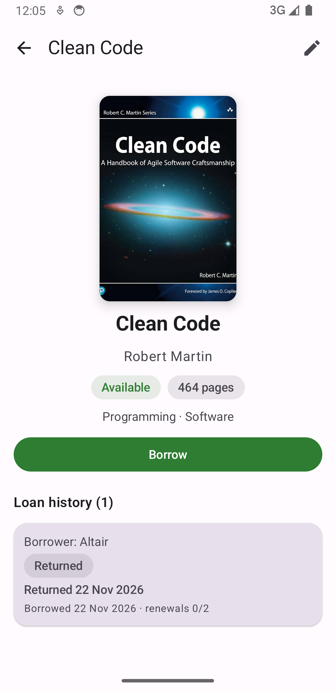
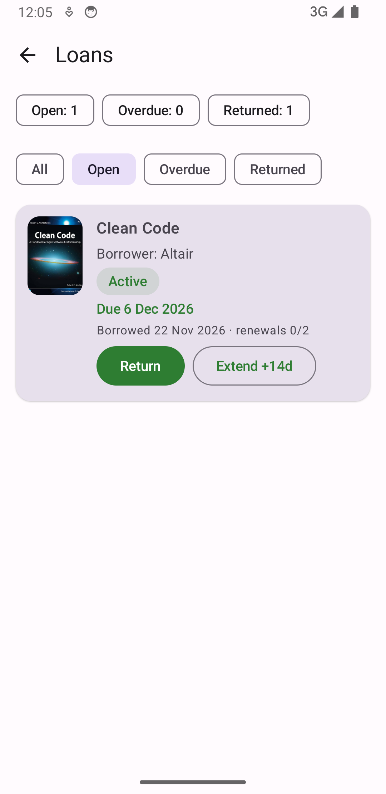
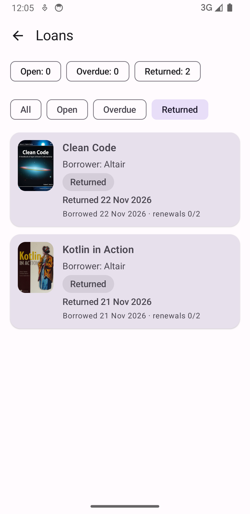
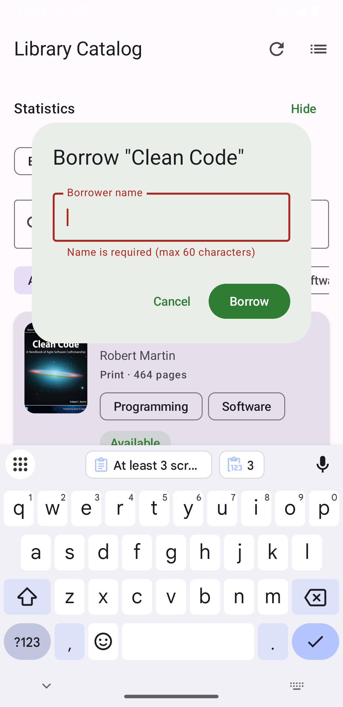

# Library Catalog (HW3)

Android app for a campus library, continuing HW1 (console) and HW2.
Architecture: **MVVM** (`ViewModel` + `StateFlow`), **Room** persistence, **Navigation Compose**,
a repository over Room `Flow`s, and **Coil** for book covers loaded from web URLs.

## Screenshots

### Updated catalog and book details

| Catalog | Book details |
|---------|--------------|
|  |  |

### Additional feature: loan workflow

| Open loan | Returned loans | Borrow validation |
|-----------|----------------|-------------------|
|  |  |  |

## Additional feature: loan workflow with history

A book can be borrowed by a named reader. The loan has a due date and a history.
Book availability is derived from loans in the database, not stored separately.

Status flow:

```
Available → borrow → Active → (due date passed) → Overdue
                       ↓                              ↓
                    return                         return
                       ↓                              ↓
                   Returned  (the book becomes Available again)
```

Business rules (enforced in `LibraryRepository` inside Room transactions):

- Loan period is 14 days.
- A loan can be extended by 14 days, at most 2 times.
- A book that is already borrowed cannot be borrowed again.
- A book with an open loan cannot be deleted.
- Returning late shows the number of late days in the feedback message.
- Every action shows a result message (snackbar), including errors.

The feature is visible on three screens:

- **Catalog:** Borrow/Return buttons and the Borrowed/Available badge on each card.
- **Book details:** Borrow button, current loan with Return/Extend, full loan history.
- **Loans:** counters (Open / Overdue / Returned), filters, and actions for each loan.

## Other features

- Catalog as a `LazyColumn` with stable keys; search by title or author; genre filter.
- Statistics row (books, print pages, genres) that can be hidden.
- Create and edit book forms with validation: required fields, id format and uniqueness,
  genre limits, page range, optional cover URL with a live preview.
- Delete with a confirmation dialog.
- Sync from a remote catalog (fake API) that adds only new books.
- Book covers loaded from web URLs; a placeholder is shown while loading or on error.

## Architecture

```
data/local     Room entities, DAOs, database, mappers
data/          LibraryRepository (all reads/writes, transactions, business rules)
data/remote    RemoteCatalog (fake remote API)
domain/        Book, Loan, LoanStatus, LoanPolicy, BusinessRuleException
ui/<screen>/   Stateless screen composable + ViewModel (StateFlow state, actions)
ui/common/     Base ViewModel with one-off events, app-wide snackbar, formatting
ui/components/ Reusable composables (BookCard, LoanCard, BookCover, StatusBadge, dialogs)
ui/form/       Form state, pure validator, ViewModel
ui/navigation/ Routes and NavHost
```

Navigation routes: `library`, `book/{bookId}`, `new-book`, `edit-book/{bookId}`, `loans`.

Persistence:

- Room database `library.db`, seeded with two books when it is created.
- Search query and filters are kept in `SavedStateHandle`, so they survive rotation.

## How to run

Requirements: Android Studio, JDK 17+, Android SDK 34, a device or emulator with API 26+ and internet access (for covers).

```bash
./gradlew :app:installDebug
```
