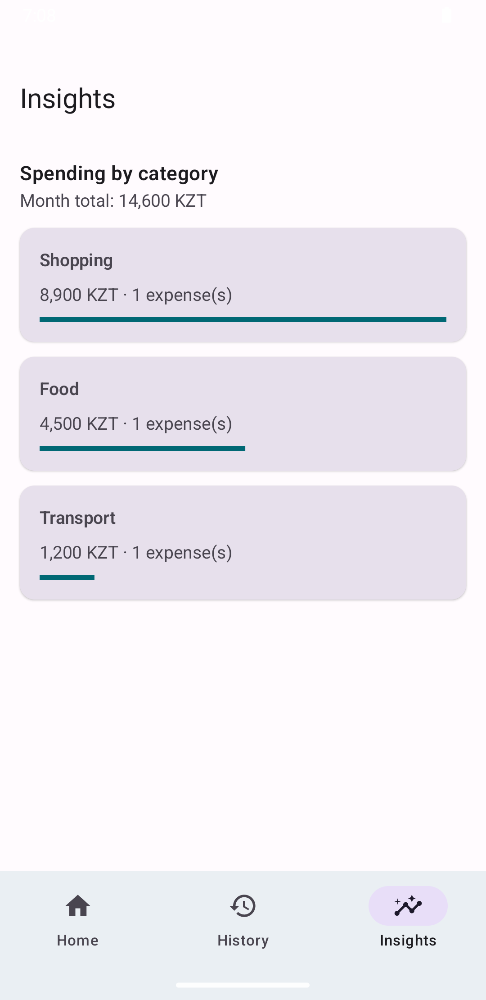
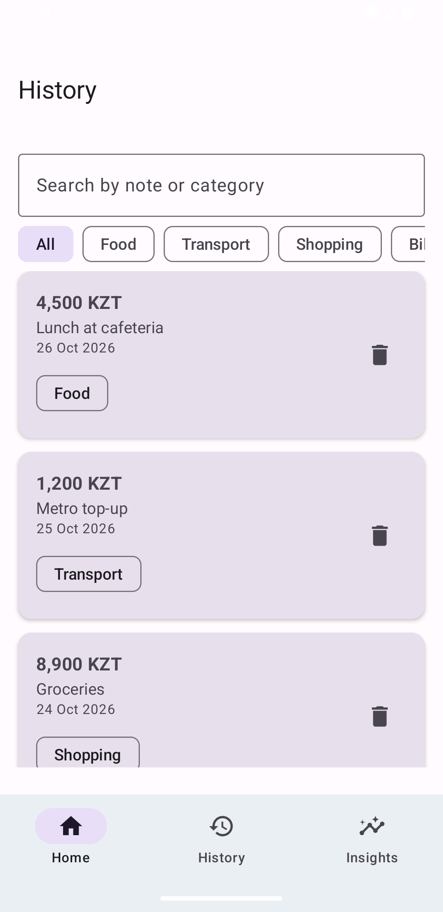

# AI Expense Tracker (Midterm)

Android app for logging personal spending in **KZT**, reviewing history, and seeing category insights. Optional **OpenRouter** integration parses natural-language descriptions into structured expense fields (amount, category, note).

## Features

- **Dashboard** — monthly total, recent expenses, FAB to add new entries
- **History** — full list with **search** and **category filter** (`FilterChip`)
- **Insights** — spending breakdown by category with progress bars
- **Add / Edit** — manual form with validation; **Parse with AI** on the add screen
- **CRUD** — add, update (tap card), delete (trash icon)
- Material 3 teal theme, reusable composables (`ExpenseCard`, `SummaryCard`, `CategoryChips`, etc.)

### Reusable composables

| Component | Location |
|-----------|----------|
| `ExpenseCard` | `ui/components/ExpenseCard.kt` |
| `SummaryCard` | `ui/components/SummaryCard.kt` |
| `CategoryChips` | `ui/components/CategoryChips.kt` |
| `AmountField` | `ui/components/AmountField.kt` |
| `EmptyState` | `ui/components/EmptyState.kt` |

### Requirements mapping (midterm PDF)

| Requirement | Implementation |
|-------------|----------------|
| ≥ 3 screens + Navigation Compose | Bottom nav: Dashboard, History, Insights; stack: Add, Edit |
| ≥ 3 meaningful features | CRUD, search/filter, insights, AI parse |
| Material 3 + reusable UI | `ExpenseTheme`, shared components |
| Input & state | Forms, chips, snackbars, list updates |
| `remember` / `rememberSaveable` / hoisting | History filters in `rememberSaveable`; add dialog fields in `remember` |
| ViewModel + StateFlow | `ExpenseViewModel`, `collectAsStateWithLifecycle()` |
| Separation of concerns | `domain/`, `data/`, `network/`, `ui/` |
| Coroutines | `viewModelScope` for OpenRouter calls |
| Configuration changes | Expenses in ViewModel; filters survive rotation via `rememberSaveable` |

## Screenshots

Dashboard with monthly total and recent expenses:


Add expense with AI-assisted parsing:



History with search and category filters:



> For defense, prefer fresh captures from an emulator or device (`adb exec-out screencap -p > screenshots/...`).

## How to run

**Requirements:** Android Studio, **JDK 17+** (Studio often uses 21), Android SDK **API 34**, device or emulator **API 26+**.

1. Open the `midterm` folder in Android Studio (File → Open).
2. Create or update `local.properties` in the project root:

   ```properties
   sdk.dir=/path/to/Android/sdk
   openrouter.api.key=sk-or-v1-...
   ```

   The API key is optional. Without it, manual entry still works; AI parse shows a snackbar explaining the missing key.

3. Run the **app** configuration on an emulator or device.

From the terminal:

```bash
cd midterm
./gradlew :app:installDebug
```

Then open **AI Expense Tracker** on the device.

## OpenRouter setup

1. Create an API key at [openrouter.ai](https://openrouter.ai/).
2. Add `openrouter.api.key=...` to `local.properties` (never commit this file).
3. Rebuild the project so `BuildConfig.OPENROUTER_API_KEY` is updated.
4. On **Add expense**, enter a short description and tap **Parse with AI**.

The app uses model `google/gemma-2-9b-it:free` and expects JSON: `amount`, `category`, `note`.

## State management (defense notes)

| Mechanism | What we store | Survives rotation? | Survives process death? |
|-----------|---------------|--------------------|-------------------------|
| **ViewModel (`StateFlow`)** | Expense list, month total, category summaries, AI loading, snackbar messages | Yes | No |
| **rememberSaveable** | History search query, selected category filter | Yes | Yes (instance state) |
| **remember** | Add-screen form fields, AI input text | No | No |

**Why this split?** Business data and totals belong in the ViewModel so rotation does not reset the catalog. Filter UI on History is user input that should survive rotation without serializing every expense into the bundle.

## Architecture

```
midterm/app/src/main/kotlin/kbtu/midterm/expense/
  domain/          # Expense, ExpenseCategory, CategorySummary
  data/            # ExpenseRepository (in-memory)
  network/         # OpenRouterClient, AiExpenseParser
  ui/
    navigation/    # ExpenseNavHost, routes
    screens/       # Dashboard, History, Insights, AddExpense
    components/    # Reusable composables
    theme/
  MainActivity.kt
```

**Navigation:** `ExpenseNavHost` hosts a `NavHost` with three top-level destinations and push routes for add/edit. Bottom bar is hidden on add/edit.

**Data flow:** UI events → `ExpenseViewModel` → `ExpenseRepository`. AI parse → `AiExpenseParser` → `OpenRouterClient` (OkHttp on `Dispatchers.IO`).

## Persistence

Expenses are stored **in memory** in the ViewModel’s repository (same session as HW2 catalog). Data survives configuration changes but not process death. Room or DataStore is a natural extension for the second half of the course.

## Project structure

Standalone Gradle project under `midterm/`; not dependent on `hw1` or `hw2` at build time.
